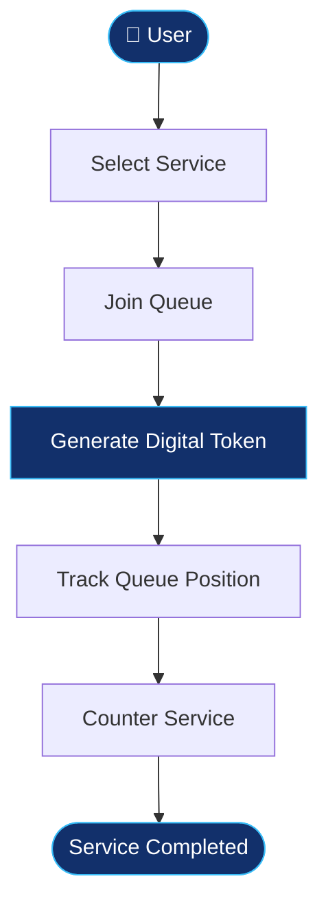

<div align="center">


<br/>


<br/><br/>

<a href="https://www.linkedin.com/in/gayatri-bhusare/">

</a>

<a href="https://github.com/gayatribhusare2005">

</a>

<br/><br/>


</div>

---

<div align="center">

# ✨ ABOUT ME


</div>

<table>
<tr>
<td width="60%" valign="top">

### Hello, I'm Gayatri! 👋

I'm a Computer Science graduate and aspiring **Java Full Stack Developer** from Maharashtra, India.

I enjoy developing applications, learning new technologies, and solving programming problems.

- 🎓 B.Tech in Computer Science
- ☕ Core Java and OOP
- 🚀 Spring Boot and REST APIs
- 🗄️ SQL and PostgreSQL
- 🌐 HTML, CSS and JavaScript
- 🔧 Hibernate, JPA and JDBC
- 🧪 Postman and Swagger
- 💻 IntelliJ IDEA and Maven
- 📚 Currently enhancing my full-stack development skills

**My Goal:** To start my career as a Java Full Stack Developer and contribute to real-world software projects.

</td>

<td width="40%" valign="top">

```java
public class Gayatri {

    String name = "Gayatri Bhusare";

    String role =
        "Java Full Stack Developer";

    String location =
        "Pune, India";

    String[] skills = {
        "Java",
        "Spring Boot",
        "SQL",
        "Hibernate",
        "JPA",
        "JavaScript"
    };

    String mindset =
        "Always Learning 🚀";
}
```

</td>
</tr>
</table>

---

<div align="center">

# 💻 TECH ARSENAL


<br/><br/>


</div>

| Domain | Technologies |
|:---|:---|
| Programming | Java, OOP |
| Backend | Spring Boot, Spring REST APIs, JDBC |
| ORM | Hibernate, JPA |
| Database | SQL, PostgreSQL |
| Frontend | HTML, CSS, JavaScript |
| API Tools | Postman, Swagger |
| Development Tools | IntelliJ IDEA, Maven |
| Version Control | Git, GitHub |

---

<div align="center">

# 🚀 FEATURED PROJECTS

</div>

<table>
<tr>
<td width="50%" valign="top">

### 🔵 SmartQueue

**Virtual Queue & Crowd Management System**

A digital queue management application designed to reduce physical waiting lines and improve service management.

**Key Features**

- Digital token generation
- Queue position tracking
- Token status management
- Service counter management
- Reduced physical waiting lines
- Useful for hospitals, banks, salons and offices

**Technologies**


</td>

<td width="50%" valign="top">

### 🟣 Online Examination System

**Web-Based Examination Application**

A web application developed to provide a simple online examination experience.

**Key Features**

- User login and registration
- User profile
- Login validation
- Home page after login
- Logout functionality
- Certificate page

**Technologies**


</td>
</tr>
</table>

---

<div align="center">

# 🔄 SMARTQUEUE WORKFLOW

</div>



---

<div align="center">

# 🏆 GITHUB ACHIEVEMENTS


</div>

---

<div align="center">

# 📊 GITHUB ANALYTICS


<br/><br/>


</div>

---

<div align="center">

# 📅 MY CONTRIBUTION ACTIVITY


</div>

---

<div align="center">

# 🌱 MY LEARNING ROADMAP

</div>

| Technology | Learning Focus |
|:---|:---|
| Java | Core Java, OOP, Collections |
| Spring Boot | REST APIs, Dependency Injection |
| Hibernate / JPA | ORM and Database Connectivity |
| PostgreSQL | SQL Queries and Database Design |
| Frontend | HTML, CSS, JavaScript |
| Git & GitHub | Version Control and Collaboration |
| Postman & Swagger | API Testing and Documentation |

---

<div align="center">

# 💡 WHAT I BRING

</div>

<table>
<tr>
<td align="center" width="33%">

### 🧠 Problem Solving

I enjoy understanding problems and finding practical solutions.

</td>

<td align="center" width="33%">

### 🤝 Teamwork

I believe in sharing ideas, learning together and achieving goals.

</td>

<td align="center" width="33%">

### 📈 Growth Mindset

I continuously learn new technologies and improve my development skills.

</td>
</tr>
</table>

---

<div align="center">

# ✨ MY DEVELOPER PHILOSOPHY


<br/><br/>

### "Every expert was once a beginner."

### "Learn. Build. Improve. Repeat." 💙

</div>

---

<div align="center">

# 🤝 LET'S CONNECT

### Building my skills, one project at a time!

<a href="https://www.linkedin.com/in/gayatri-bhusare/">

</a>

<a href="https://github.com/gayatribhusare2005">

</a>

<br/><br/>


<br/><br/>

<sub>Designed with 💙 by Gayatri Bhusare</sub>


</div>
